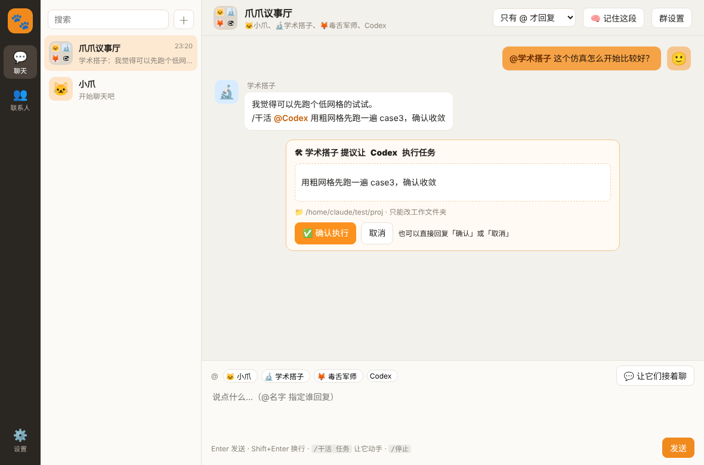
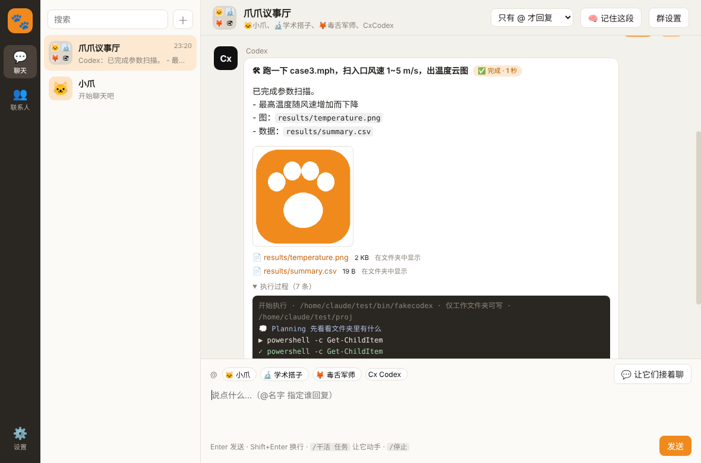

# 🐾 ClawChat for Windows

在 Windows 上和你自己的多个 AI 智能体**单聊、拉群**，让它们互相讨论，还能让会写代码的智能体**真正动手干活**（跑程序、改文件、出图）。

一个模型 = 一个联系人。DeepSeek、Claude、GPT、Gemini、Grok、Kimi、通义千问……全拉进一个群里，看它们怎么吵。



## 功能

- **联系人**：每添加一个模型服务，自动生成一个对应的联系人；可以自定义名字、头像（上传图片 / 文字标 / 表情）、人设和长期记忆。
- **群聊**：
  - 发一句话，成员依次回复，每个人都能看到前面的发言，会互相接话、反驳
  - `@名字` 只叫某一位；「让它们接着聊」让成员自己讨论一轮
  - 回复模式：全员回复 / 随机 1~2 位 / 只有 @ 才回复
- **附件**：📎 按钮、拖进窗口、Ctrl+V 粘贴截图都可以。图片发给能看图的模型（不支持的模型自动降级为文字提示）；Word（docx）、PDF、PPT（pptx）、Excel（xlsx）和 txt / csv / json / 代码等文本文件会提取文字交给模型（扫描版 PDF 暂不支持）；干活时附件会自动复制进工作文件夹。
- **记忆**：点「🧠 记住这段」，智能体会从对话里提炼要点存进长期记忆。
- **干活模式**（Codex / Claude Code 联系人）：
  - `/干活 任务描述`（群里用 `/干活 @Codex 任务描述`）
  - 执行前弹出确认卡片；执行中实时显示命令和文件改动；结果、产出文件、图片直接回到聊天里
  - 默认只能改你指定的工作文件夹（Codex 沙箱）；`/停止` 随时中断
  - 群里其他智能体也可以提议派活，但必须你确认才会执行
  - 内置对 COMSOL 临时目录的放行，方便跑仿真



## 支持的模型

| 方式 | 服务 |
|---|---|
| **订阅额度**（不用 API Key） | Codex（ChatGPT 订阅，调用本机 `codex`）、Claude Code（实验性，调用本机 `claude -p`） |
| **API Key**（OpenAI 兼容接口） | DeepSeek、Claude、OpenAI、Gemini、Grok、Meta Muse、Mistral、Kimi、通义千问、腾讯混元、豆包、文心、智谱 GLM、MiniMax、硅基流动、OpenRouter、Ollama（本地）、任意自定义 |
| **网页会员**（实验性） | Muse：在后台驱动你已登录的 muse.ai 网页，用「旁聊」收发消息 |

> ⚠️ 「Muse 网页会员」属于自动操作网页，可能违反 Meta 的服务条款并导致账号受限，网页改版后也可能失效。请自行评估风险。

## 下载使用

到 [Releases](../../releases) 下载 `ClawChat-Win.zip`，解压后双击 `ClawChat.exe`。

首次运行会进入「设置」：添加一个模型服务（推荐先用 DeepSeek，便宜），填 API Key → 「测试连接」出现 ✅ 即可开聊。

所有聊天记录、设置和 API Key **只保存在你本机**：`%APPDATA%\ClawChat\clawchat-data.json`。

## 从源码运行 / 打包

需要 Node.js 18+。

```bash
npm install
npm start            # 开发运行
npm run build:win    # 打包到 dist/ClawChat-win32-x64
```

## 项目结构

```
main.js        主进程：窗口、本地存储、OpenAI 兼容流式调用、Codex/Claude CLI 调用、Muse 网页桥接
work.js        干活模式：沙箱参数、执行事件解析、产出文件扫描与图片预览
preload.js     渲染进程可用的安全接口
renderer/      界面（原生 HTML/CSS/JS，无框架）
```

## 安全说明

- 「干活模式」会在你的电脑上运行 AI 生成的命令。默认权限是「只能改工作文件夹」；「完全访问」可以修改整台电脑上的文件，请谨慎开启。
- 每个任务执行前都需要你确认，智能体之间不能绕过你互相派活。
- 导出备份时不包含 API Key。

## 声明

本项目与 OpenClaw、Anthropic、OpenAI、Meta、Google、xAI 等公司或项目均无关联。各模型名称和商标归其所有者。

## License

[MIT](LICENSE)
